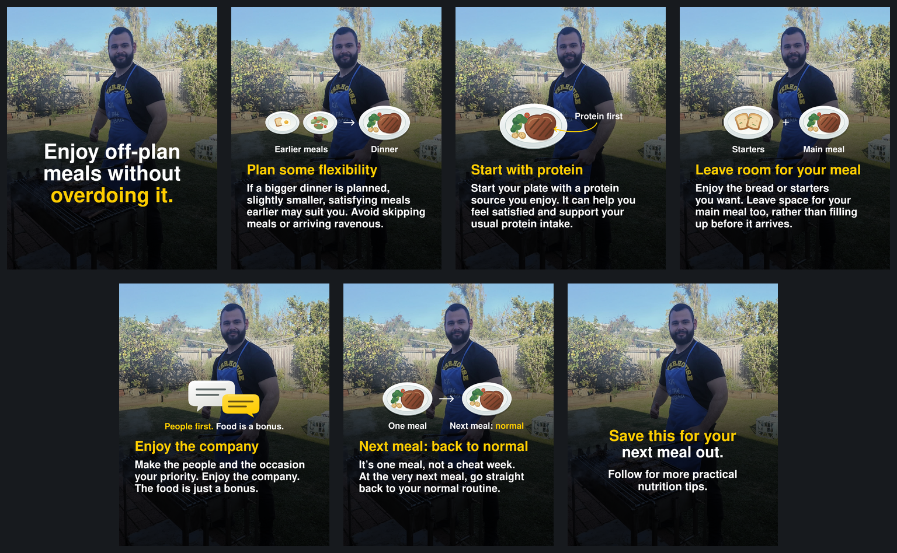

# Off-plan meals carousel — version 2

Seven finished Instagram slides, each **1080 × 1350 pixels** (4:5 portrait).

Slide 5 now makes the company and occasion the priority, with food as a bonus. New slide 6 says to return to your normal routine at the very next meal; the CTA is now slide 7.

- [Download the seven PNG slides](https://github.com/MetamorphPhysique/Metamorph-ChatGPT/raw/refs/heads/main/carousel/off-plan-meals/off-plan-meals-v2-slides.zip) — 14.6 MiB. Unzip and upload in filename order, 01 through 07.
- [Download the editable project and assets](https://github.com/MetamorphPhysique/Metamorph-ChatGPT/raw/refs/heads/main/carousel/off-plan-meals/off-plan-meals-v2-editable.zip) — 25.1 MiB. Includes SVG layouts, the shared photograph, original vector diagrams, fonts, slide copy and source notes.
- [Open the updated carousel preview](carousel/off-plan-meals/carousel-preview-v2.png).

The original photograph is preserved with one shared crop and gradient. The face remains clear throughout. Nimbus Sans substitutes for Helvetica Neue. Copy is based on the supplied transcript screenshots and the requested revisions; the source video was not accessible.

Version 1 remains available: [original six slides](carousel/off-plan-meals/off-plan-meals-slides.zip), [original editable project](carousel/off-plan-meals/off-plan-meals-editable.zip), and [original preview](carousel/off-plan-meals/carousel-preview.png).

If a direct download asks you to sign in, use a GitHub account with access to this repository. You can also open either ZIP in the repository and use GitHub's download control.
