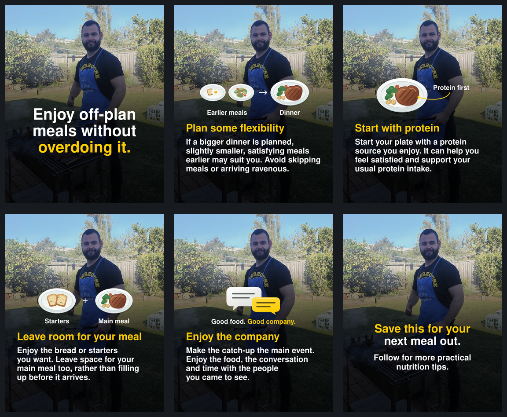

# Off-plan meals carousel

Six finished Instagram slides, each **1080 × 1350 pixels** (4:5 portrait).

- [Download the six PNG slides](https://github.com/MetamorphPhysique/Metamorph-ChatGPT/raw/refs/heads/main/carousel/off-plan-meals/off-plan-meals-slides.zip) — 12.5 MiB. Unzip and upload in filename order, 01 through 06.
- [Download the editable project and assets](https://github.com/MetamorphPhysique/Metamorph-ChatGPT/raw/refs/heads/main/carousel/off-plan-meals/off-plan-meals-editable.zip) — 22.7 MiB. Includes SVG layouts, the shared photograph, original vector diagrams, fonts, slide copy and source notes.
- [Open the full carousel preview](carousel/off-plan-meals/carousel-preview.png).

The original photograph is preserved with one shared crop and gradient. The face remains clear throughout. Nimbus Sans substitutes for Helvetica Neue. Copy is based on the supplied transcript screenshots; the source video was not accessible.

If a direct download asks you to sign in, use a GitHub account with access to this repository. You can also open either ZIP in the repository and use GitHub's download control.
